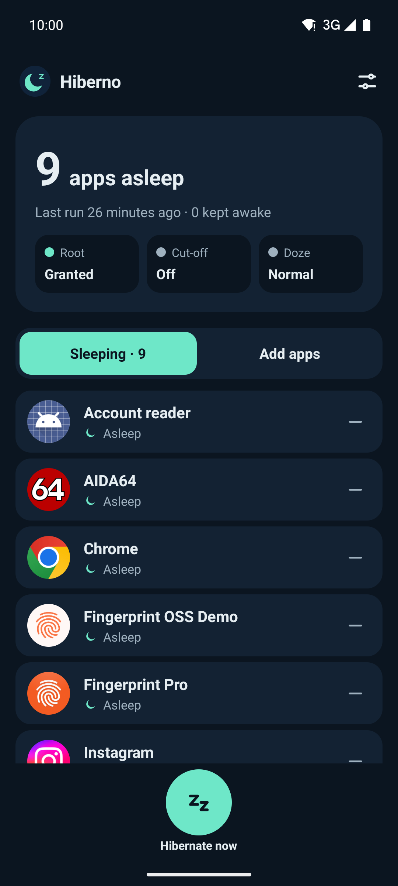
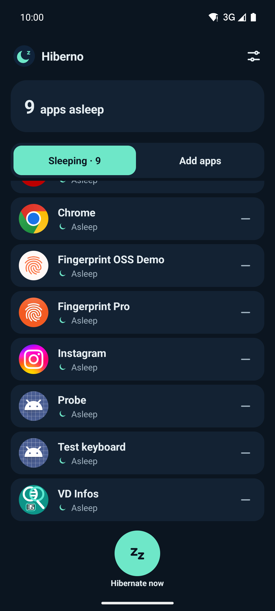
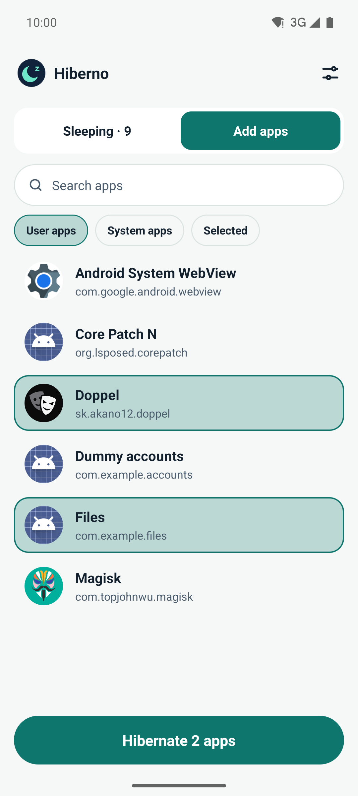
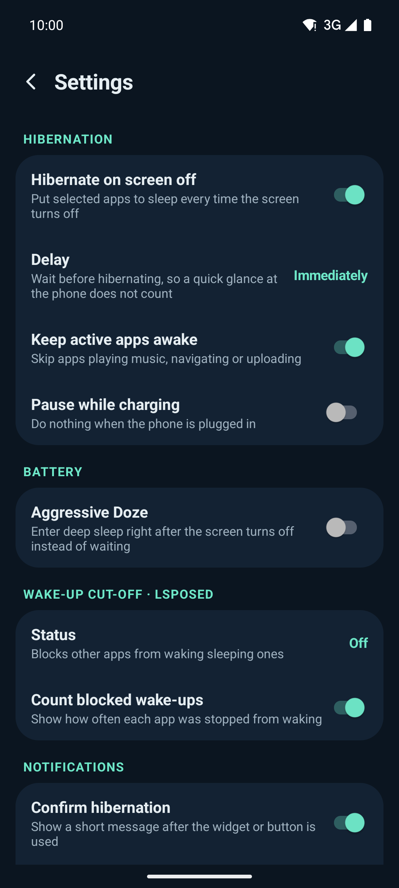
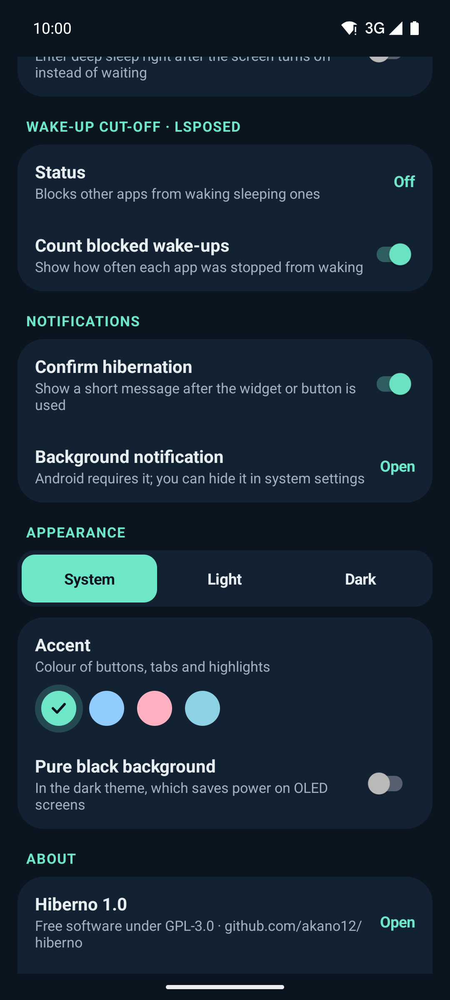
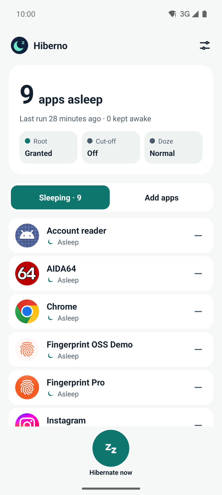

<p align="center">
  
</p>

<h1 align="center">Hiberno</h1>

<p align="center">
  Put battery-draining apps to sleep when you're not using them.<br>
  A modern, root-based alternative to Greenify for current Android versions.
</p>

<p align="center">
  
  
  
  <a href="LICENSE"></a>
</p>

<p align="center">
  <a href="#screenshots">Screenshots</a> ·
  <a href="#features">Features</a> ·
  <a href="#how-it-works">How it works</a> ·
  <a href="#installation">Installation</a> ·
  <a href="#faq">FAQ</a> ·
  <a href="#building">Building</a> ·
  <a href="#license">License</a>
</p>

Some apps keep running in the background long after you close them: they wake up for every broadcast,
schedule jobs and alarms, and wake each other up, costing battery and warming the phone.
Greenify used to fix this, but it is no longer maintained and misbehaves on new Android versions.

Hiberno does the same job with current tools: it **hibernates** the apps you pick (stops them completely)
every time the screen turns off, using root through [libsu](https://github.com/topjohnwu/libsu).
An optional [LSPosed](https://github.com/LSPosed/LSPosed) module, written against the
[modern Xposed API](https://github.com/libxposed/api), stops other apps from waking them up again.

Screenshots
-----------

<table>
  <tr>
    <td align="center"><br><sub>Sleeping apps</sub></td>
    <td align="center"><br><sub>Scrolling</sub></td>
    <td align="center"><br><sub>Add apps</sub></td>
  </tr>
  <tr>
    <td align="center"><br><sub>Settings</sub></td>
    <td align="center"><br><sub>Appearance</sub></td>
    <td align="center"><br><sub>Light theme</sub></td>
  </tr>
</table>

Features
--------

**Hibernation**
* Hibernates the apps you pick every time the screen turns off, or right away with **Hibernate now**
* Optional delay (1, 5 or 15 minutes) so a quick glance at the phone doesn't count
* Keeps apps awake while they are actively in use: playing music, navigating, uploading (apps with a foreground service)
* Pause while charging
* Newly added apps show as *Awaiting hibernation* until they are stopped; the list shows which apps are asleep and which were kept awake

**Battery**
* Aggressive Doze: sends the phone into deep sleep right after the screen turns off instead of waiting

**Wake-up cut-off (LSPosed, optional)**
* Stops other apps, broadcasts, services, content providers and alarms from starting a hibernated app
* Opening the app yourself always works, and it stays awake until the next screen-off
* Optional count of blocked wake-ups per app

**Home-screen widgets**
* 1×1 quick button and 2×1 widget with the number of sleeping apps; one tap hibernates, nothing opens

**Look and feel**
* Light, dark or system theme
* Four accent colours (Teal, Ocean, Berry, Sky) and a pure black background for OLED screens
* Themed (monochrome) launcher icon on Android 13 and later
* Starts again by itself after a reboot

How it works
------------

* **Hibernating an app** means force-stopping it as root (`am force-stop`). Android then treats it as
  *stopped*: it gets no alarms, jobs or implicit broadcasts until it is opened again. Apps running a
  foreground service are skipped when *Keep active apps awake* is on.
* **Screen off** is detected by a small, low-priority foreground service. Android requires its notification;
  you can hide it in the system notification settings (Settings → Notifications → Background notification).
* **The wake-up cut-off** is an LSPosed module for the *System Framework*. It intercepts process starts in
  `system_server` and refuses to start a hibernated app for anything other than an activity, which means
  for anything except you opening it. Hiberno tells the module which apps are hibernated through LSPosed's
  remote preferences. If a hook doesn't match your Android version, the module lets everything through
  instead of blocking.
* **Aggressive Doze** runs `dumpsys deviceidle force-idle` on screen off and undoes it on screen on.

Installation
------------

### Requirements

* Android 10 or later
* Root, for example with [Magisk](https://github.com/topjohnwu/Magisk)
* Optional: [LSPosed](https://github.com/LSPosed/LSPosed) with modern Xposed API (101 or later) support, for the wake-up cut-off

### Steps

1. Build the APK (see [Building](#building)) and install it.
2. Open Hiberno and grant root when your root manager asks.
3. Open **Add apps**, tap the apps you want to hibernate, then tap **Hibernate N apps**.
4. Optional: in LSPosed, enable the Hiberno module for **System Framework** and reboot.
   The *Cut-off* tile on the main screen then shows *Active*.
5. Optional: add a Hiberno widget to your home screen.

FAQ
---

**Will I still get notifications from hibernated apps?**
No. Android does not deliver push messages to stopped apps. Don't hibernate messengers or other apps
whose notifications you need.

**Why does a hibernated app's widget or notification button do nothing?**
With the wake-up cut-off active, those count as background starts and are blocked. Open the app once
and they work again until the next screen-off.

**An app I use for music or navigation was stopped.**
Make sure *Keep active apps awake* is on in Settings. It only protects apps that are running a
foreground service at the moment the screen turns off.

**The blocked wake-up counts look low.**
They are read from the system log, which is a fixed-size ring buffer, so older entries can be dropped
on busy phones.

Permissions
-----------

| Permission | Why |
|---|---|
| Root (via your root manager) | Force-stop apps and control Doze |
| `FOREGROUND_SERVICE`, `FOREGROUND_SERVICE_SPECIAL_USE` | Notice the screen turning off |
| `RECEIVE_BOOT_COMPLETED` | Start again after a reboot |
| `POST_NOTIFICATIONS` | Show the service notification (Android requires one) |
| `QUERY_ALL_PACKAGES` | List your installed apps to choose from |

Hiberno has no internet permission and collects no data.

Building
--------

Requirements: JDK 21 and the Android SDK with platform 37.

```sh
./gradlew assembleRelease   # APK in app/build/outputs/apk/release/
./gradlew test              # unit tests
```

The release build is signed with the debug key; use your own signing config before distributing it.

Project layout:

| Path | What |
|---|---|
| `app/src/main/kotlin/dev/hiberno/` | App, hibernation service, widgets, LSPosed module (`Cutoff.kt`) |
| `app/src/main/resources/META-INF/xposed/` | Modern Xposed API module metadata and scope |
| `app/src/test/` | Unit tests for the cut-off rules, root script and log parsing |

License
-------

Hiberno is free software: you can redistribute it and/or modify it under the terms of the
[GNU General Public License version 3](LICENSE) as published by the Free Software Foundation.

It uses libsu, libxposed and the Kotlin standard library, all under the Apache License 2.0;
see [THIRD_PARTY_NOTICES.md](THIRD_PARTY_NOTICES.md).
